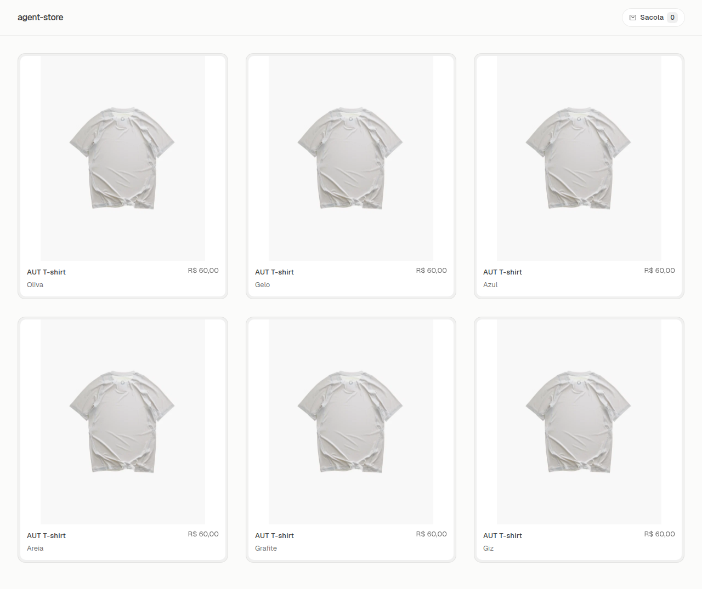
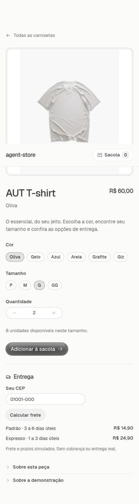

# Migração da Agent Store para Glaze

25/10/2026. Implementação local na branch `feat/glaze-storefront`; sem push ou deploy nesta entrega.

## Escopo

Vitrine, detalhes da camiseta, sacola, contato/endereço, frete, checkout, confirmação, cancelamento e página `/agents` migrados para componentes e tokens oficiais do Glaze. Tema importado em `src/main.tsx`, body com classe `glaze`, overlays no `GlazePortalProvider`. Skills instaladas em `.agents/skills` e `.claude/skills`; `AGENTS.md` registra o contrato para futuras alterações.

Frontend React/Vite/TypeScript. API, catálogo, preços em centavos BRL, estoque, reservas, tokens e SQLite continuam em Go. Pagamentos e frete permanecem simulados. O build do frontend é incorporado ao binário; o runtime final não precisa de Node. Dockerfile atualizado e validado.

## Validação final

* `npm run build`, `npx eslint -c glaze.eslint.config.mjs .`, `go test ./...`, `go vet ./...`, `node scripts/legacy.mjs --zero import,mixed,raw,palette` e `git diff --check`: passaram.
* `scripts/verify-browser.cjs` e `scripts/verify-recovery.cjs`: passaram contra SQLite local descartável. Incluem frete padrão/expresso, variantes, edição da sacola, Pix, cancelamento com cartão, reload, perda de resposta e idempotência estável.
* Comparação antes/depois em uma única rodada com mutações interceptadas: corpos de checkout, simulação de pagamento, cotação e frete iguais.
* 44 combinações de tela/estado em 320, 390, 768 e 1280 px: nenhuma violação detectada pelo axe nos conjuntos WCAG 2A/AA e 2.1 AA; nenhum erro de JavaScript/console ou overflow.
* Tab, foco visível, isolamento do Sheet, Escape e retorno à sacola conferidos. Estados de carregamento e falha HTTP 503 recuperam sem perder campos.
* Event Timing: 668 eventos observados, máximo de 48 ms nesta máquina; não é benchmark ou garantia para outros dispositivos.
* Proporção das imagens conferida no navegador e protegida na suíte. Três colunas no desktop, duas no tablet e uma no celular.
* Imagem Docker final compilou e respondeu `/healthz`, serviu o frontend atual e a licença Geist. Contêiner temporário removido após o teste.

Os testes não enviaram pedidos à loja pública. A varredura automatizada e os fluxos observados não substituem uma avaliação completa de acessibilidade ou segurança.

## Ajustes de integração

O tema foi instalado em `src/components/glaze`; seus caminhos `@source` foram ajustados para alcançar o `src` real. O tema é a única entrada Tailwind da UI; remover a entrada global duplicada evitou estilos de dois sistemas competindo. Ícones adicionais continuam centralizados em `components/glaze/icon.tsx`. NumberInput ganhou rótulos opcionais para os steppers em português.

Cor e tamanho usam Chip controlado para mostrar a seleção. A sacola oferece recuperação de cotação e de criação incerta sem descartar a chave e o corpo da tentativa. Campos e controles têm nomes acessíveis distintos por cor.

## Evidências visuais

Relatório independente e capturas completas ficam na pasta local ignorada `.ui-review` e nas evidências temporárias da execução. As capturas usam somente dados fictícios.
